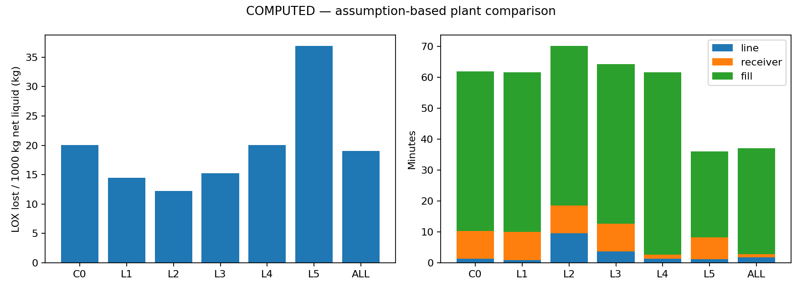
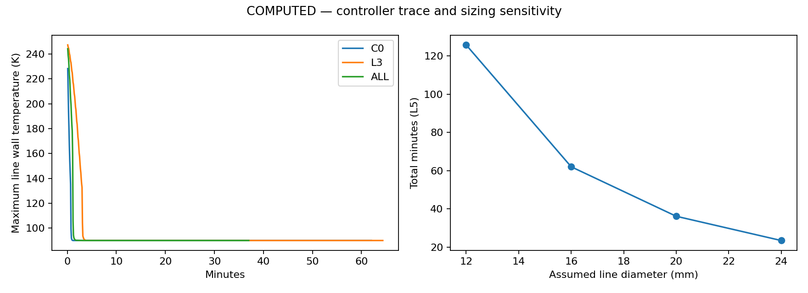

# CryoLink transfer lever study

All results below are **COMPUTED (our model)** and rest on **ASSUMPTION**. Comparison is against C0 conventional transfer, with the same plant, initial conditions and net-liquid target. No competitor performance is inferred.

| Case | LOX lost kg / 1000 kg | Total min | Settling propellant kg | Failed / aborted fills | LOX saved vs C0 kg |
|---|---:|---:|---:|---:|---:|
| C0 | 20.02 | 62.01 | 17.743 | 0/40 (0.0%) | 0.00 |
| L1 | 14.47 | 61.71 | 17.655 | 0/40 (0.0%) | 5.54 |
| L2 | 12.22 | 70.26 | 20.099 | 0/40 (0.0%) | 7.79 |
| L3 | 15.26 | 64.37 | 18.418 | 0/40 (0.0%) | 4.76 |
| L4 | 20.02 | 61.72 | 17.659 | 10/40 (25.0%) | 0.00 |
| L5 | 36.94 | 36.10 | 10.332 | 0/40 (0.0%) | -16.92 |
| ALL | 19.01 | 37.04 | 10.602 | 10/40 (25.0%) | 1.01 |

Under nominal assumptions, ALL saves 1.01 kg LOX, 24.97 minutes and 7.14 kg host settling propellant per transfer. The larger line drives the time saving. L2 saves more LOX but takes longer; L3 trades some of that saving for a shorter chilldown. L4 aborts in 10/40 trials and ALL in 10/40; the post-chill gate cannot prevent overpressure during chill. These findings support a design trade study, not a demonstrated flight performance claim.

Phase times (minutes), COMPUTED:

- C0: line 1.26, receiver 9.02, fill 51.73; settling 62.01.
- L1: line 0.95, receiver 9.02, fill 51.73; settling 61.71.
- L2: line 9.50, receiver 9.04, fill 51.72; settling 70.26.
- L3: line 3.62, receiver 9.03, fill 51.73; settling 64.37.
- L4: line 1.26, receiver 1.40, fill 59.06; settling 61.72.
- L5: line 1.26, receiver 7.02, fill 27.82; settling 36.10.
- ALL: line 1.71, receiver 1.14, fill 34.19; settling 37.04.

## Interpretation and scope

Positive savings mean less client LOX spent per 1000 kg net liquid retained. Negative values mean a penalty. Lever effects are one-at-a-time against C0; ALL includes interactions, so individual savings must not be added. No dollar saving is asserted without a client propellant price.

C0 is a bare line, continuous flow and fixed phase durations established by a nominal commissioning run; receiver cooling is bulk liquid/pool/ullage exchange without direct spray-wall heat transfer. Production C0/L1/L2/L4/L5 retain their commissioned durations under uncertainty. L3 uses measured maximum wall temperature, varies duty from 0.10 hot to 0.50 near rewet, and waits for wall readiness for 30 s. L4 uses receiver spray plus coating/pulsing; the line remains conventional. L5 increases line diameter and assumed hydraulic conductance; it does not impose a gain for crossing 700 kg/m²s. ALL combines these and an assumed wall-readiness gate.

The spray gain multiplies the spray heat-transfer conductance, not a measured total propellant-saving factor. Its LN2-to-LOX and coupon-to-tank mapping is an ASSUMPTION swept from 1 to 2.13. The coating is represented by an effective rewet-superheat threshold (40–120 K sweep), not a resolved coating conduction layer. Published LN2 mass savings are context, not direct multipliers applied to results.

Settling acceleration is the recorded plant value 1.05e-4 g. Host initial mass 10,000 kg and thruster Isp 220 s are ASSUMPTIONS. Settling is maintained throughout line chill, receiver chill and fill; propellant = M0 [1 − exp(−a t/(Isp g0))]. Mass sensitivity is linear; Isp sensitivity is provided by this equation (e.g. 100–300 s). Docking, leak check, top-off, purge and demating are excluded from every case.

Loss = tanker liquid withdrawn − final receiver liquid. This includes line dumps, vented oxygen and oxygen retained as receiver vapor; it is a client liquid-delivery cost, not solely oxygen ejected into space. Plant vent bookkeeping includes gas mixture mass and is not used as an oxygen loss meter. Net liquid target is 1000 kg; successful losses are scaled by 1000/actual delivery to remove timestep overshoot. Times and settling consumption refer to the simulated crossing (overshoot is recorded).

MC uses paired draws with seed 261. N7 reports LH2 wall-temperature MAPE, not a LOX probability distribution. We ASSUME independent initial-wall temperature discrepancies at the two line ends and receiver, interpolate axially, draw Gaussian errors with mean absolute fractional error uniformly 22–28%, and clip to −45%/+65%. This is an illustrative model-discrepancy stress test, not a validated reliability prediction. Sensors are exact here; model error is not sensor error. Failure means receiver pressure ≥3.8 bar, fill fraction >98% before 1000 kg, timeout at 16000 s, or a rejected gate. Wilson 95% binomial intervals and successful-run loss ranges are recorded in JSON; these describe sampling under the assumed distribution, not flight reliability. Counts combine aborted and unsuccessful attempts; the JSON records reasons and each run. A zero failure count does not establish zero risk.

The ALL gate is a conservative wall-readiness check, not NASA’s validated thermodynamic target-temperature model. It runs after receiver conditioning; it can be redundant. gate_off in results.json isolates its nominal effect. No extra saving is attributed to NASA’s reported 100% failure classification.

Reproduction: `python run.py --samples 40 --dt 0.1` (Python 3, matplotlib). Reads the original FSW files and saves exact snapshots plus SHA-256 hashes locally. Physics is extracted from the original Plant class without importing ROS or modifying fsw. Source downloads are not required to rerun. Default runtime is recorded in results.json. All assumptions and source quotations are in [SOURCES.md](SOURCES.md).

## Validation and baseline differences

This study reuses the Plant physics but uses a standalone sequencer. The user’s existing nominal run (1007.4 kg withdrawn, 995.4 kg delivered, 12 kg loss; 506/277/3400 s) uses pulsing and spray already, and is not C0. We do not calibrate C0 to those numbers or claim to reproduce ROS timing. The present target is net receiver liquid rather than the original delivered flow counter. Pressure control uses a simple common bang-bang supply regulator and common receiver vent hysteresis. The existing plant has no fluid holdup, two-phase hydraulic resistance or spatial receiver wall distribution. Off-pulse residual-fluid cooling is absent; this can penalize pulsing and prevents quantitative validation against the paper’s measured pulse advantage.

Half-step check C0: loss change -0.142 kg; total time change -0.092 min.
Half-step check ALL: loss change +0.258 kg; total time change +0.058 min.
Maximum oxygen mass-balance residual: 3.55e-11 kg across nominal and Monte Carlo runs.

Sensitivity sweeps are saved in results.json for every unsourced lever parameter; failed sensitivity runs retain raw partial-attempt losses and must not be compared as completed 1000 kg transfers; they are scenario bounds, not confidence intervals. Host mass/Isp scaling is analytic. The nominal comparison cannot establish a flight-qualified saving.

Context checked: fsw/README.md, Plant/common/controller/property tables; research/MOAT_BEYOND_1104.md N1–N13, PEOPLE_RESEARCH_1104.md Q1–Q16, TECH_EDGE_1103.md; original line paper and spray paper, Kim thesis abstract, NASA N7 and RGCT slides. Work remained inside sims/levers.
