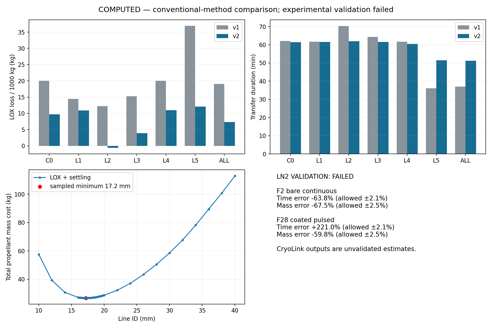

# CryoLink lever study v2

**COMPUTED — experimental validation FAILED.** These are assumption-dependent comparisons with the conventional C0 method. They do not demonstrate flight savings or establish an exclusive invention.

Validation was run before the CryoLink sizing search and lever simulations. The independent LN2 fixture uses the published 0.914 m long, 12.7 mm OD, 0.51 mm wall tube, a 60.48 µm four-layer coating, 0.05 g, and F2/F28 mass fluxes. F28 uses 3 s / 10% pulses. It uses the same line solver and heat-transfer functions as CryoLink; it does not use receiver physics or any imposed saving factor.

F2 bare continuous: predicted 5.28 s versus 14.60 s measured (-63.8%), and 0.2832 kg discharged versus 0.8720 kg (-67.5%). The paper states 2.1% time and 2.5% mass uncertainty; this case fails. Off-pulse wall cooling is 0 J.

F28 coated pulsed: predicted 23.27 s versus 7.25 s measured (+221.0%), and 0.1101 kg discharged versus 0.2740 kg (-59.8%). The paper states 2.1% time and 2.5% mass uncertainty; this case fails. Off-pulse wall cooling is 2964 J.

The predicted paired mass saving is 61.1%. The paper's table gives 68.6% from 0.872 kg and 0.274 kg; its narrative gives about 75–76%. Neither number was used to fit the model. The approximately 67% 1 g / 20% duty comparison comes from a different experiment and was not simulated here.

This is an attempted reproduction with incomplete boundary data: 293 K initial wall, 77 K inlet and a constant 325 kPa mean test-section pressure are ASSUMPTIONS. The F28 table footnote says its time-series mass-flow data are missing. Applying its listed final mass flux as valve-on flow is an ASSUMPTION, with 1/4/10× flow sensitivity retained. The outer-wall derivative end criterion is approximated by all wall nodes below local saturation +5 K and mean cooling slope below 0.5 K/s for 0.2 s. Pressure, starting temperature, residual inventory, drain time, inlet temperature, steel properties and end-criterion sensitivities are in validation_v2.json; fixture heat-leak bounds are in validation_supplement_v2.json and results_v2.json. A match obtained by selecting those free inputs would require a separate calibration and independent validation.

Before → after model: v1 has no residual-fluid state, a three-level assumed HTC curve, and coating represented by an 80 K rewet threshold. V2 carries liquid mass and enthalpy in each axial cell, vaporizes and drains residual inventory with the inlet shut, and routes that outflow to the receiver or dump. It computes radial coating resistance δ/k(T) with a separate fluid-facing surface temperature. Nominal thickness is CAD D_COATING_T = 50 µm; the paper thicknesses are swept. The layer uses a quasi-steady temperature gradient with no coating heat capacity; it is not a transient multilayer/contact-resistance reconstruction.

V2 uses the source-visible Darr–Hartwig film-boiling/rewet equations and linear transition heat-flux interpolation from N7, with Purdue/GRC reduced-gravity nucleate boiling equations (2024, Eqs. 19–29). The N7 slide leaves nucleate coefficients symbolic. The separate 2023 universal chilldown poster also leaves coefficients unspecified. V2 therefore uses a documented hybrid, with an assumed CHF-temperature anchor and bounded rewet extension, rather than claiming the complete validated correlation sets. Purdue DFFB Eq. 43 and the old assumed curve are explicit alternative sweeps. Saturated-property approximations, LH2-to-LN2/LOX use, oxygen extrapolation beyond the Purdue NB database, near-zero-flow extrapolation and the simple liquid-retention law remain unvalidated. Details and equation provenance are in SOURCES.md.

All cells below show **v1 → v2**. Loss, time and settling are nominal completed-transfer results; abort counts use the same paired 40 draws (or the requested subset). Failed attempts are retained raw in JSON and excluded from sizing minima. C0 is continuous bare-line transfer; L1 coating, L2 fixed pulses, L3 measured-temperature adaptive pulses, L4 receiver spray plus pressure control, L5 sizing, ALL combined. L4 retains the v1 assumed spray conductance enhancement; no resolved receiver-coating layer is claimed. L5/ALL also change from the v1 20 mm line to the v2 mass optimum, so this table compares complete studies rather than isolating physics alone. The ablations below separate the inventory, boiling-curve and pressure-control effects. The conventional study line remains the inherited 16 mm ID × 5 m / 4 kg metal model; the CAD bore and route are not substituted into that baseline.

| Case | LOX lost kg / 1000 kg | Total min | Settling propellant kg | Aborted/failed MC |
|---|---:|---:|---:|---:|
| C0 | 20.02 → 9.67 | 62.01 → 61.44 | 17.74 → 17.58 | 0/40 → 0/40 |
| L1 | 14.47 → 10.85 | 61.71 → 61.50 | 17.65 → 17.60 | 0/40 → 0/40 |
| L2 | 12.22 → -0.63 | 70.26 → 61.88 | 20.10 → 17.70 | 0/40 → 0/40 |
| L3 | 15.26 → 3.94 | 64.37 → 61.59 | 18.42 → 17.62 | 0/40 → 0/40 |
| L4 | 20.02 → 10.99 | 61.72 → 60.50 | 17.66 → 17.31 | 10/40 → 0/40 |
| L5 | 36.94 → 12.05 | 36.10 → 51.41 | 10.33 → 14.71 | 0/40 → 0/40 |
| ALL | 19.01 → 7.31 | 37.04 → 51.24 | 10.60 → 14.66 | 10/40 → 0/40 |

Physics ablations, COMPUTED: with the v2 inventory solver but the legacy HTC curve, C0 loses 19.86 kg and takes 62.00 min (outcome success). L2 with zero liquid holdup loses 1.52 kg and takes 63.61 min (outcome success). Nominal L2 removes 82526 J between pulses, 30.2% of its line-wall heat extraction over the complete transfer. These ablations distinguish the new mechanisms from the complete v1/v2 comparison.

L4 controller ablation within v2: control off 10/40 (25.0%) failed/aborted, control on 0/40 (0.0%). Reasons off: {'overpressure_abort': 10, 'success': 30}; on: {'success': 40}. This separates the controller change from changing line physics. The control opens/closes the receiver vent at 2.6/2.2 bar and pauses/resumes receiver spray at 2.9/2.4 bar. All four setpoints are ASSUMPTIONS with sweeps; the 3.8 bar abort is retained. Exact sensors and instantaneous valves limit what these counts establish. Each controller variant is commissioned with its own nominal fixed phase durations before applying the paired draws.

ALL controller ablation within v2: control off 7/40 (17.5%) failed/aborted, control on 0/40 (0.0%). Reasons off: {'overpressure_abort': 7, 'success': 33}; on: {'success': 40}. This separates the controller change from changing line physics. The control opens/closes the receiver vent at 2.6/2.2 bar and pauses/resumes receiver spray at 2.9/2.4 bar. All four setpoints are ASSUMPTIONS with sweeps; the 3.8 bar abort is retained. Exact sensors and instantaneous valves limit what these counts establish. Each controller variant is commissioned with its own nominal fixed phase durations before applying the paired draws.

L5's bounded nominal minimum is 17.2 mm ID: 12.05 kg lost LOX + 14.71 kg settling propellant = 26.76 kg. Search: 8–40 mm in 2 mm steps, then ±1.8 mm around the best coarse size in 0.2 mm steps. This is a sampled minimum in that domain, not a global optimum or a qualified line design. ALL uses the same selected size; ALL is not independently size-optimized. Diameter also scales line volume, wall area, metal mass and assumed hydraulic conductance ∝D^2.5. Alternative hydraulic exponents, host masses and Isp have separate coarse re-optimizations in JSON. An equal kilogram sum is the requested mass objective, not an economic valuation of two different propellants.

Under these assumptions ALL versus C0 changes LOX loss by -2.37 kg, transfer time by -10.20 min, and settling propellant by -2.92 kg. Because LN2 validation failed, these values cannot support a quantitative product-performance pitch. The source experiment supports the coating/pulsing mechanism relative to conventional chilldown; this study has not established its LOX system benefit. Coating alone increases nominal loss relative to v2 C0, so resolving the conduction layer has not reproduced the published coating advantage.

The Monte Carlo is the exact v1 seed-261 draw array: independent initial-wall discrepancy at both line ends and receiver, Gaussian mapping of an assumed 22–28% mean absolute discrepancy, clipped to −45/+65%. Fixed phase durations are recommissioned once under v2 nominal physics and frozen for MC; L3/ALL respond to wall temperature. These are stress-test frequencies under that assumed distribution, not flight reliability. Valve on-times are quantized to the timestep; non-integral duty sweep settings and the adaptive schedule do not have exact continuous-time duties. Wilson intervals, successful-loss ranges, raw attempts and failure reasons are in results_v2.json. No attempts are silently discarded.

Bookkeeping: loss = tanker liquid withdrawn − final receiver liquid, including residual line liquid, dumps, vents and oxygen left in vapor. Initial receiver oxygen can condense, so small negative calculated loss is possible and is not creation of oxygen. Net delivery is 1000 kg; successful losses are normalized for timestep overshoot. Settling uses the inherited 1.05×10⁻⁴ g over all three phases, 10,000 kg host and 220 s Isp, with rocket-equation mass/Isp sensitivity. No docking or leak-check time is included.

Maximum oxygen mass-balance residual across nominal/MC attempts: 4.54e-11 kg. The local physics checks pass: residual liquid cools with inlet shut, empty cells do not cool, added coating resistance reduces film-regime flux, and cell mass/enthalpy accounting closes. These are numerical checks, not experimental validation.

Half-step C0: loss change +0.163 kg, time change -0.085 min; fine-step outcome success. This checks the selected nominal design; the diameter grid itself is not re-optimized at half-step.

Half-step ALL: loss change -0.072 kg, time change +0.112 min; fine-step outcome success. This checks the selected nominal design; the diameter grid itself is not re-optimized at half-step.

Reproduce with `python check_v2.py > checks_v2.json` then `python run_v2.py --samples 40 --dt 0.1`. Requires Python, CoolProp and matplotlib already installed here. Main run CPU 34.37 min (excludes earlier source inspection, diagnostic runs and the small fixture supplement); wall 29.27 min. No source downloads are needed to rerun. V1 run.py, results.json, README.md and images are preserved. V2 reads the v1 plant snapshots and CAD thickness without changing FSW or CAD.

Context checked: v1 README/SOURCES/run/results and plant snapshots; CAD params.py; FSW README and research MOAT_BEYOND_1104/TECH_EDGE_1103; published line/spray text, N7 slides, Purdue/GRC 2024 equations and NIST coating data; HANDOFF_ALL, memory index, matching earlier project transcripts and read-only Crab inbox CryoLink search. No project handoff file was found in cryolink.
